<a href="https://danidev.cl/en">
  <picture>
    <source media="(prefers-color-scheme: dark)" srcset="./assets/header-dark-en.svg">
    <source media="(prefers-color-scheme: light)" srcset="./assets/header-light-en.svg">
    
  </picture>
</a>

<p align="center">
  <a href="./README.md">Español</a> · <b>English</b>
</p>

<p align="center">
  <a href="https://danidev.cl/en"></a>
  <a href="https://www.linkedin.com/in/d-moraga-tenorio/"></a>
  <a href="mailto:d.moraga.tenorio@gmail.com"></a>
  <a href="https://www.instagram.com/dysast3r/"></a>
</p>

<br>

### `~/about-me`

I build web products that feel fast and convert: **high-performance landing pages**, **custom systems** for small businesses and **N8N + AI automations** that save teams hours every week. Based in Santiago, Chile, working remotely with clients across Latin America and beyond.

```ts
const daniel = {
  role: 'Full Stack Web Developer',
  base: 'Santiago, Chile · remote',
  focus: ['Landing pages', 'SaaS & custom systems', 'Automation with N8N + AI'],
  shipped: '10+ projects in production',
  contact: 'd.moraga.tenorio@gmail.com',
};
```

<br>

<a name="stack">
  <picture>
    <source media="(prefers-color-scheme: dark)" srcset="./assets/stack-dark-en.svg">
    <source media="(prefers-color-scheme: light)" srcset="./assets/stack-light-en.svg">
    
  </picture>
</a>

<br><br>

### `~/featured-projects`

<p align="center">
  <a href="https://cupo.danidev.cl/"><picture><source media="(prefers-color-scheme: dark)" srcset="./assets/cards/cupo-dark-en.svg"><source media="(prefers-color-scheme: light)" srcset="./assets/cards/cupo-light-en.svg"></picture></a>
  <a href="https://www.rockpass.cl/"><picture><source media="(prefers-color-scheme: dark)" srcset="./assets/cards/rockpass-dark-en.svg"><source media="(prefers-color-scheme: light)" srcset="./assets/cards/rockpass-light-en.svg"></picture></a>
</p>
<p align="center">
  <a href="https://code-wear.danidev.cl/"><picture><source media="(prefers-color-scheme: dark)" srcset="./assets/cards/code-wear-dark-en.svg"><source media="(prefers-color-scheme: light)" srcset="./assets/cards/code-wear-light-en.svg"></picture></a>
  <a href="https://bbtech.cl/"><picture><source media="(prefers-color-scheme: dark)" srcset="./assets/cards/bbtech-dark-en.svg"><source media="(prefers-color-scheme: light)" srcset="./assets/cards/bbtech-light-en.svg"></picture></a>
</p>

<p align="center"><a href="https://danidev.cl/en#projects"><sub><b>See every project on danidev.cl →</b></sub></a></p>

<br>

### `~/activity`

<a name="activity">
  <picture>
    <source media="(prefers-color-scheme: dark)" srcset="https://raw.githubusercontent.com/Dysast3r/Dysast3r/output/stats-dark-en.svg">
    <source media="(prefers-color-scheme: light)" srcset="https://raw.githubusercontent.com/Dysast3r/Dysast3r/output/stats-light-en.svg">
    
  </picture>
</a>

<a name="contributions">
  <picture>
    <source media="(prefers-color-scheme: dark)" srcset="https://raw.githubusercontent.com/Dysast3r/Dysast3r/output/snake-dark.svg">
    <source media="(prefers-color-scheme: light)" srcset="https://raw.githubusercontent.com/Dysast3r/Dysast3r/output/snake-light.svg">
    
  </picture>
</a>

<br><br>

<a href="https://danidev.cl/en#contact">
  <picture>
    <source media="(prefers-color-scheme: dark)" srcset="./assets/footer-dark-en.svg">
    <source media="(prefers-color-scheme: light)" srcset="./assets/footer-light-en.svg">
    
  </picture>
</a>
