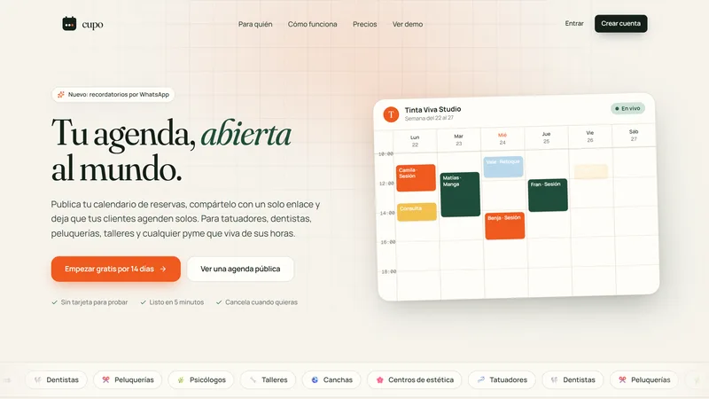
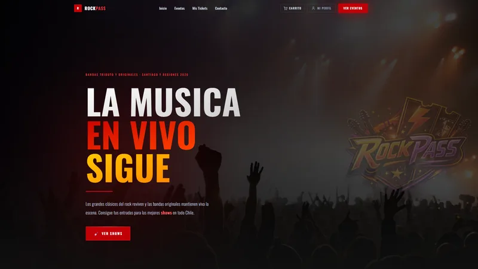
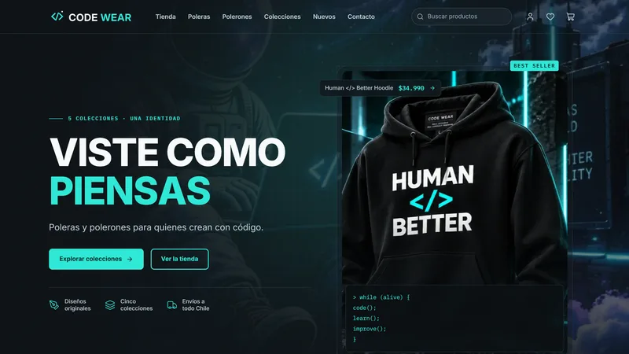
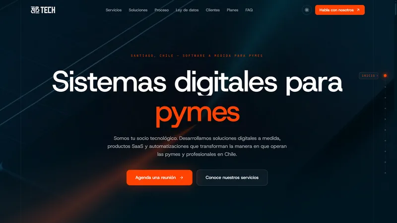

<a href="https://danidev.cl">
  <picture>
    <source media="(prefers-color-scheme: dark)" srcset="./assets/header-dark.svg">
    <source media="(prefers-color-scheme: light)" srcset="./assets/header-light.svg">
    
  </picture>
</a>

<p align="center">
  <a href="https://danidev.cl"></a>
  <a href="https://www.linkedin.com/in/d-moraga-tenorio/"></a>
  <a href="mailto:d.moraga.tenorio@gmail.com"></a>
  <a href="https://www.instagram.com/dysast3r/"></a>
</p>

<br>

### `~/sobre-mi`

Construyo productos web que se sienten rápidos y venden: **landing pages de alto rendimiento**, **sistemas a medida** para pymes y **automatizaciones con N8N e IA** que le ahorran horas a los equipos. Trabajo desde Santiago, Chile, de forma remota para clientes en Latinoamérica.

```ts
const daniel = {
  rol: 'Desarrollador Web Full Stack',
  base: 'Santiago, Chile · remoto',
  enfoque: ['Landing pages', 'SaaS y sistemas a medida', 'Automatización con N8N + IA'],
  proyectos: '+10 entregados en producción',
  contacto: 'd.moraga.tenorio@gmail.com',
};
```

<br>

### `~/stack`

<table>
  <tr>
    <td width="150"><sub><b>FRONTEND</b></sub></td>
    <td></td>
  </tr>
  <tr>
    <td><sub><b>BACKEND Y DATOS</b></sub></td>
    <td></td>
  </tr>
  <tr>
    <td><sub><b>AUTOMATIZACIÓN E IA</b></sub></td>
    <td>
      
      
      
    </td>
  </tr>
  <tr>
    <td><sub><b>HERRAMIENTAS</b></sub></td>
    <td></td>
  </tr>
</table>

<br>

### `~/proyectos-destacados`

<table>
  <tr>
    <td width="50%" valign="top">
      <a href="https://cupo.danidev.cl/"></a>
      <br><b><a href="https://cupo.danidev.cl/">Cupo</a></b> · <sub>SaaS de reservas</sub>
      <br><sub>Las pymes publican su agenda en una página propia y reciben reservas 24/7, sin coordinar horarios por WhatsApp.</sub>
    </td>
    <td width="50%" valign="top">
      <a href="https://www.rockpass.cl/"></a>
      <br><b><a href="https://www.rockpass.cl/">RockPass</a></b> · <sub>Ticketing</sub>
      <br><sub>Venta de entradas para shows en vivo con pagos reales en producción y panel de administración.</sub>
    </td>
  </tr>
  <tr>
    <td width="50%" valign="top">
      <a href="https://code-wear.danidev.cl/"></a>
      <br><b><a href="https://code-wear.danidev.cl/">Code Wear</a></b> · <sub>E-commerce</sub>
      <br><sub>Tienda para developers con catálogo, colecciones, carrito lateral y animaciones fluidas.</sub>
    </td>
    <td width="50%" valign="top">
      <a href="https://bbtech.cl/"></a>
      <br><b><a href="https://bbtech.cl/">BBTech</a></b> · <sub>Sistemas para pymes</sub>
      <br><sub>Landing de alta conversión para una empresa que vende sistemas digitales a pymes. SEO técnico y animaciones avanzadas.</sub>
    </td>
  </tr>
</table>

<p align="center"><a href="https://danidev.cl/#projects"><sub><b>Ver todos los proyectos en danidev.cl →</b></sub></a></p>

<br>

### `~/actividad`

<p align="center">
  <picture>
    <source media="(prefers-color-scheme: dark)" srcset="https://raw.githubusercontent.com/Dysast3r/Dysast3r/output/stats-dark.svg">
    <source media="(prefers-color-scheme: light)" srcset="https://raw.githubusercontent.com/Dysast3r/Dysast3r/output/stats-light.svg">
    
  </picture>
</p>

<p align="center">
  <picture>
    <source media="(prefers-color-scheme: dark)" srcset="https://raw.githubusercontent.com/Dysast3r/Dysast3r/output/snake-dark.svg">
    <source media="(prefers-color-scheme: light)" srcset="https://raw.githubusercontent.com/Dysast3r/Dysast3r/output/snake-light.svg">
    
  </picture>
</p>

<br>

<p align="center">
  <sub>¿Tienes un proyecto en mente? <a href="https://danidev.cl/#contact"><b>Hablemos</b></a></sub>
</p>
