<a href="https://danidev.cl">
  <picture>
    <source media="(prefers-color-scheme: dark)" srcset="./assets/header-dark.svg">
    <source media="(prefers-color-scheme: light)" srcset="./assets/header-light.svg">
    
  </picture>
</a>

<p align="center">
  <b>Español</b> · <a href="./README.en.md">English</a>
</p>

<p align="center">
  <a href="https://danidev.cl"></a>
  <a href="https://www.linkedin.com/in/d-moraga-tenorio/"></a>
  <a href="mailto:d.moraga.tenorio@gmail.com"></a>
  <a href="https://www.instagram.com/dysast3r/"></a>
</p>

<br>

### `~/sobre-mi`

Construyo productos web que se sienten rápidos y venden: **landing pages de alto rendimiento**, **sistemas a medida** para pymes y **automatizaciones con N8N e IA** que le ahorran horas a los equipos. Trabajo desde Santiago, Chile, de forma remota para clientes en Latinoamérica.

```ts
const daniel = {
  rol: 'Desarrollador Web Full Stack',
  base: 'Santiago, Chile · remoto',
  enfoque: ['Landing pages', 'SaaS y sistemas a medida', 'Automatización con N8N + IA'],
  proyectos: '+10 entregados en producción',
  contacto: 'd.moraga.tenorio@gmail.com',
};
```

<br>

<a name="stack">
  <picture>
    <source media="(prefers-color-scheme: dark)" srcset="./assets/stack-dark.svg">
    <source media="(prefers-color-scheme: light)" srcset="./assets/stack-light.svg">
    
  </picture>
</a>

<br><br>

### `~/proyectos-destacados`

<p align="center">
  <a href="https://cupo.danidev.cl/"><picture><source media="(prefers-color-scheme: dark)" srcset="./assets/cards/cupo-dark.svg"><source media="(prefers-color-scheme: light)" srcset="./assets/cards/cupo-light.svg"></picture></a>
  <a href="https://www.rockpass.cl/"><picture><source media="(prefers-color-scheme: dark)" srcset="./assets/cards/rockpass-dark.svg"><source media="(prefers-color-scheme: light)" srcset="./assets/cards/rockpass-light.svg"></picture></a>
</p>
<p align="center">
  <a href="https://code-wear.danidev.cl/"><picture><source media="(prefers-color-scheme: dark)" srcset="./assets/cards/code-wear-dark.svg"><source media="(prefers-color-scheme: light)" srcset="./assets/cards/code-wear-light.svg"></picture></a>
  <a href="https://bbtech.cl/"><picture><source media="(prefers-color-scheme: dark)" srcset="./assets/cards/bbtech-dark.svg"><source media="(prefers-color-scheme: light)" srcset="./assets/cards/bbtech-light.svg"></picture></a>
</p>

<p align="center"><a href="https://danidev.cl/#projects"><sub><b>Ver todos los proyectos en danidev.cl →</b></sub></a></p>

<br>

### `~/actividad`

<a name="actividad">
  <picture>
    <source media="(prefers-color-scheme: dark)" srcset="https://raw.githubusercontent.com/Dysast3r/Dysast3r/output/stats-dark.svg">
    <source media="(prefers-color-scheme: light)" srcset="https://raw.githubusercontent.com/Dysast3r/Dysast3r/output/stats-light.svg">
    
  </picture>
</a>

<a name="contribuciones">
  <picture>
    <source media="(prefers-color-scheme: dark)" srcset="https://raw.githubusercontent.com/Dysast3r/Dysast3r/output/snake-dark.svg">
    <source media="(prefers-color-scheme: light)" srcset="https://raw.githubusercontent.com/Dysast3r/Dysast3r/output/snake-light.svg">
    
  </picture>
</a>

<br><br>

<a href="https://danidev.cl/#contact">
  <picture>
    <source media="(prefers-color-scheme: dark)" srcset="./assets/footer-dark.svg">
    <source media="(prefers-color-scheme: light)" srcset="./assets/footer-light.svg">
    
  </picture>
</a>
